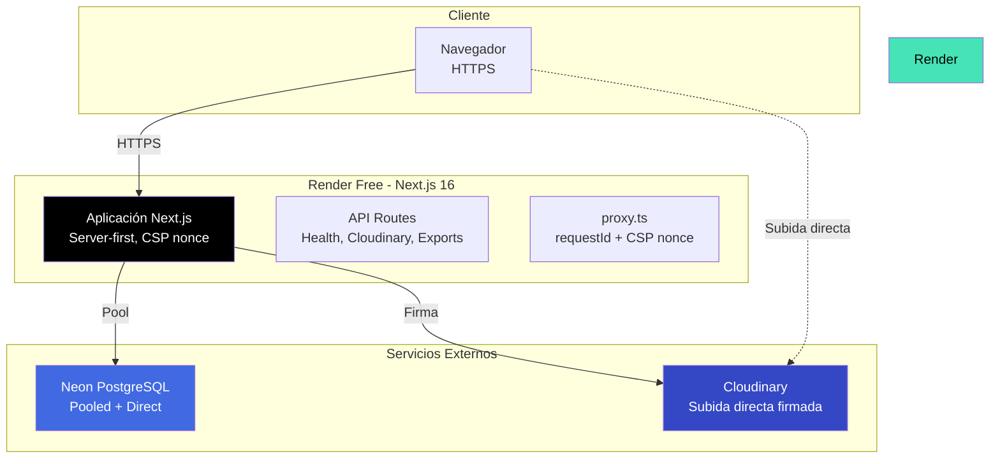
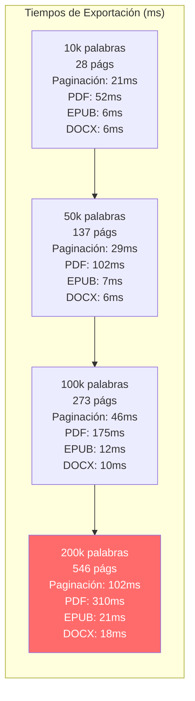
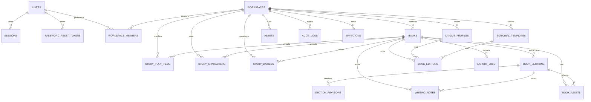

# ESCRIBIENDO

<div align="center">


**Plataforma editorial privada de [EDITORIAL NO PARA TODOS](https://editorialnoparatodos.com)**

[](https://nodejs.org/)
[](https://pnpm.io/)
[](https://nextjs.org/)
[](https://react.dev/)
[](https://www.typescriptlang.org/)
[](https://tailwindcss.com/)
[](https://www.postgresql.org/)
[](https://www.prisma.io/)
[](https://zod.dev/)
[](https://vitest.dev/)
[](https://playwright.dev/)
[](https://render.com/)
[](https://neon.tech/)
[](https://cloudinary.com/)

[](LICENSE)
[](docs/ROADMAP.md)
[](docs/TESTING.md)
[](docs/SECURITY_AUDIT.md)

</div>

---

ESCRIBIENDO reúne **escritura, edición, maquetación y preparación de archivos de imprenta** en un único espacio de trabajo. Este repositorio contiene las **Fases 1 a 6** completamente implementadas y verificadas, más las **herramientas de historia** (planificación, personajes y mundos) como extensión de la Fase 3.

> **No hay registro público.** El acceso se crea una sola vez mediante `/setup` y un token de instalación de alta entropía. Después, solo un administrador puede crear cuentas mediante invitaciones.

---

## 🎯 Resumen Ejecutivo

| Métrica                                   | Valor                           |
| ----------------------------------------- | ------------------------------- |
| **Líneas de código**                      | ~45,000+ (TypeScript estricto)  |
| **Pruebas unitarias**                     | 374 pasando                     |
| **Pruebas E2E**                           | 72 en Chromium                  |
| **Fases completadas**                     | 6/7 + Herramientas de historia  |
| **Tablas en BD**                          | 22 (con 18 `CHECK` constraints) |
| **Rutas de la app**                       | 30 (Next.js App Router)         |
| **Paquetes internos**                     | 6 (domain-driven)               |
| **Tiempo de exportación (200k palabras)** | < 600 ms (PDF/EPUB/DOCX)        |
| **Memoria pico (con 80 imágenes)**        | 367 MB / 512 MB (Render Free)   |

---

## 📊 Estado de Implementación por Fases

```mermaid
gantt
    title Fases de ESCRIBIENDO
    dateFormat  YYYY-MM-DD
    axisFormat  %b %Y

    section Fase 1: Fundaciones
    Monorepo, TS estricto, ESLint, Prettier    :done, f1a, 2026-10-01, 7d
    Esquema PostgreSQL + migraciones            :done, f1b, after f1a, 5d
    Auth: Argon2id, sesiones opacas, setup      :done, f1c, after f1b, 7d
    Cloudinary firma, CSP nonce, health checks  :done, f1d, after f1c, 5d
    Docs: arquitectura, seguridad, despliegue   :done, f1e, after f1d, 3d

    section Fase 2: Biblioteca y Manuscritos
    CRUD libros, metadatos, búsqueda            :done, f2a, after f1e, 7d
    Estructura jerárquica secciones             :done, f2b, after f2a, 5d
    Editor Tiptap + guardado + concurrencia     :done, f2c, after f2b, 7d
    Revisiones inmutables + progreso            :done, f2d, after f2c, 5d
    27 pruebas E2E                              :done, f2e, after f2d, 3d

    section Fase 3: Escritura Asistida
    Notas privadas + objetivos + estadísticas   :done, f3a, after f2e, 7d
    Comentarios editoriales + flujo revisión    :done, f3b, after f3a, 7d
    Comparador diff LCS + preferencias          :done, f3c, after f3b, 5d
    37 pruebas E2E                              :done, f3d, after f3c, 3d

    section Fase 4: Maquetación
    Perfiles página + geometría validada        :done, f4a, after f3d, 5d
    Plantillas sistema + propias                :done, f4b, after f4a, 5d
    Motor paginación por altura                 :done, f4c, after f4b, 7d
    Vista previa escala real + diagnóstico      :done, f4d, after f4c, 5d
    46 pruebas E2E                              :done, f4e, after f4d, 3d

    section Fase 5: Exportación
    PDF digital/imprenta (fuentes incrustadas)  :done, f5a, after f4e, 7d
    EPUB 3 + DOCX                               :done, f5b, after f5a, 5d
    Cola idempotente sin worker + descarga      :done, f5c, after f5b, 5d
    56 pruebas E2E                              :done, f5d, after f5c, 3d

    section Fase 6: Equipo y Gobernanza
    Invitaciones + roles + asignaciones         :done, f6a, after f5d, 7d
    Auditoría exportable + retención            :done, f6b, after f6a, 5d
    6 pruebas E2E                               :done, f6c, after f6b, 2d

    section Herramientas Historia
    Planificación (tablero Kanban)              :done, h1, after f6c, 5d
    Personajes (fichas completas)               :done, h2, after h1, 3d
    Mundos (lugares, culturas, sistemas)        :done, h3, after h2, 3d
    Migración pendiente en Neon                 :active, h4, after h3, 2d

    section Fase 7: Operación Editorial
    Cubiertas + lomo + control versiones        :active, f7a, after h4, 14d
    Pruebas imprenta + catálogo interno         :active, f7b, after f7a, 10d
    Backups verificados + MFA + monitorización  :active, f7c, after f7b, 7d
```

---

## 🏗️ Arquitectura del Sistema



### Topología de Ejecución

```
┌─────────────────────────────────────────────────────────────┐
│                        NAVEGADOR                              │
│                      (HTTPS, CSP nonce)                       │
└──────────────────────────┬────────────────────────────────────┘
                           │
                           ▼
┌─────────────────────────────────────────────────────────────┐
│                  RENDER FREE (1 instancia)                   │
│  ┌─────────────────────────────────────────────────────┐    │
│  │           NEXT.JS 16 - APP ROUTER                    │    │
│  │  • Server Components por defecto                     │    │
│  │  • Server Actions con validación origen              │    │
│  │  • CSP estricta con nonce por petición               │    │
│  │  • dynamic = "force-dynamic" en layout raíz          │    │
│  └─────────────────────────────────────────────────────┘    │
└──────────────────────────┬────────────────────────────────────┘
                           │
           ┌───────────────┴───────────────┐
           ▼                               ▼
┌─────────────────────────┐   ┌─────────────────────────┐
│    NEON POSTGRESQL      │   │      CLOUDINARY         │
│  • Pooled para la app   │   │  • Subida directa       │
│  • Directa para migrate │   │  • Firma en servidor    │
│  • 16 tablas, 18 CHECK  │   │  • Secreto nunca en     │
│  • 3 índices parciales  │   │    el navegador         │
│  • Trigger inmutabilidad│   │                         │
└─────────────────────────┘   └─────────────────────────┘
```

**No hay:** Redis, colas, cron jobs, workers permanentes, servicios de pago obligatorios.

---

## 📦 Estructura del Monorepo

```mermaid
graph TD
    Root[escribiendo/]

    Root --> Apps[apps/]
    Root --> Packages[packages/]
    Root --> Workers[workers/]
    Root --> Scripts[scripts/]
    Root --> Tests[tests/]
    Root --> Docs[docs/]

    Apps --> Web[web/ - Next.js App]
    Web --> AppDir[src/app/ - Rutas, layouts, API]
    Web --> Components[src/components/ - UI por dominio]
    Web --> Lib[src/lib/ - Lógica de negocio]
    Web --> Proxy[src/proxy.ts - CSP + requestId]

    Components --> CompApp[app/ - Shell privado]
    Components --> CompAuth[auth/ - Formularios acceso]
    Components --> CompAccount[account/ - Cuenta]
    Components --> CompBooks[books/ - Biblioteca, editor]
    Components --> CompWriting[writing/ - Notas, objetivos]
    Components --> CompStory[story/ - Planificación, PJ, mundos]
    Components --> CompReview[review/ - Comentarios, flujo]
    Components --> CompLayout[layout/ - Perfiles, maqueta, preview]
    Components --> CompExport[export/ - Cola, generación, descarga]
    Components --> CompForms[forms/ - Campos reutilizables]
    Components --> CompBrand[brand/ - Marca]
    Components --> CompTheme[theme/ - Claro/oscuro]

    Lib --> LibAuth[auth/ - Sesiones, passwords, acciones]
    Lib --> LibBooks[books/ - Biblioteca, secciones, revisiones]
    Lib --> LibWriting[writing/ - Notas, objetivos, stats]
    Lib --> LibStory[story/ - Planificación, PJ, mundos]
    Lib --> LibReview[review/ - Comentarios, comparación]
    Lib --> LibLayout[layout/ - Perfiles, plantillas, preview]
    Lib --> LibCloudinary[cloudinary/ - Firma subidas]
    Lib --> LibSecurity[security/ - Origen, CSRF, rate limit]
    Lib --> LibUI[ui/ - Formato fechas, roles, agentes]

    Packages --> DB[database/ - Prisma Client + esquema]
    Packages --> Shared[shared/ - Validaciones comunes]
    Packages --> BookSchema[book-schema/ - Tiptap + diff]
    Packages --> EditorialEngine[editorial-engine/ - Geometría + paginación]
    Packages --> Templates[templates/ - Plantillas editoriales]
    Packages --> ExportEngine[export-engine/ - PDF, EPUB, DOCX]

    Workers --> ExportWorker[export-worker/ - Reservado fase futura]

    Scripts --> Admin[admin-password-reset.ts]
    Scripts --> Retention[retention-clean.ts]
    Scripts --> Bench[benchmark-export.ts]
    Scripts --> Stress[stress-export.ts]
    Scripts --> Prisma[prisma.ts - Wrapper CLI]

    Tests --> E2E[e2e/ - Playwright 72 tests]

    Docs --> Arch[ARCHITECTURE.md]
    Docs --> Sec[SECURITY.md]
    Docs --> DBDoc[DATABASE.md]
    Docs --> Deploy[DEPLOYMENT.md]
    Docs --> Test[TESTING.md]
    Docs --> Road[ROADMAP.md]
    Docs --> Perf[PERFORMANCE_REPORT.md]
    Docs --> ExportVal[EXPORT_VALIDATION.md]
    Docs --> EditEngine[EDITORIAL_ENGINE.md]
    Docs --> Audits[AUDIT_*.md]
```



---

## 🔐 Modelo de Seguridad y Autorización

```mermaid
graph TD
    subgraph "Autenticación"
        Setup[/setup - Instalación única<br/>SETUP_TOKEN alta entropía]
        Login[POST /login - Server Action<br/>Validación origen + Rate limit IP]
        Argon2[Argon2id<br/>19 MiB, 3 iteraciones, paralelismo 1]
        Session[Token 32 bytes aleatorio<br/>SHA-256 en BD<br/>Cookie __Host-HttpOnly-Secure]
        Reset[Recuperación CLI<br/>Token un solo uso<br/>SHA-256 en BD]
    end

    subgraph "Autorización por Rol"
        Owner[OWNER<br/>Gestión total + propietario intransferible]
        Admin[ADMIN<br/>Gestión equipo + editorial]
        Editor[EDITOR<br/>Escritura + maquetación + exportación]
        Author[AUTHOR<br/>Escritura + secciones]
        Reviewer[REVIEWER<br/>Solo lectura + comentarios]
    end

    Setup --> Login
    Login --> Argon2
    Argon2 --> Session
    Login --> Reset
    Session --> Owner
    Session --> Admin
    Session --> Editor
    Session --> Author
    Session --> Reviewer

    style Setup fill:#ff6b6b,color:#fff
    style Argon2 fill:#4ecdc4,color:#fff
    style Session fill:#45b7d1,color:#fff
```

### Matriz de Permisos (Fuente de Verdad: `permissions.ts`)

| Acción                            | OWNER | ADMIN | EDITOR | AUTHOR | REVIEWER |
| --------------------------------- | ----- | ----- | ------ | ------ | -------- |
| `book:create/update/changeStatus` | ✅    | ✅    | ✅     | ✅     | ❌       |
| `book:delete`                     | ✅    | ✅    | ❌     | ❌     | ❌       |
| `book:approve`                    | ✅    | ✅    | ✅     | ❌     | ❌       |
| `section:create/update/move`      | ✅    | ✅    | ✅     | ✅     | ❌       |
| `section:delete`                  | ✅    | ✅    | ❌     | ❌     | ❌       |
| `revision:restore`                | ✅    | ✅    | ✅     | ❌     | ❌       |
| `comment:create`                  | ✅    | ✅    | ✅     | ✅     | ✅       |
| `comment:resolve`                 | ✅    | ✅    | ✅     | ✅     | ❌       |
| `layout:manage` / `export:create` | ✅    | ✅    | ✅     | ❌     | ❌       |
| `team:manage` / `audit:export`    | ✅    | ✅    | ❌     | ❌     | ❌       |
| `story:manage`                    | ✅    | ✅    | ✅     | ✅     | ❌       |

---

## 📈 Rendimiento: Datos Reales, Medidos

### Exportación de Manuscritos (Benchmark Real)



> **Coste lineal confirmado:** 200,000 palabras = ~550 páginas en **< 1 segundo total**

### Prueba de Esfuerzo: 200k palabras + 80 imágenes + 500 notas

| Formato  | Tiempo       | Tamaño        | Contenido                                                        |
| -------- | ------------ | ------------- | ---------------------------------------------------------------- |
| **PDF**  | **588 ms**   | **40,159 KB** | 547 págs, 80 imágenes, TrimBox/BleedBox/CropBox, marcas de corte |
| **EPUB** | **1,413 ms** | **39,517 KB** | 80 imágenes incrustadas, nav.xhtml, OPF válido                   |
| **DOCX** | **1,355 ms** | **39,505 KB** | Estilos, saltos de página, relaciones                            |

- **Paginación 547 páginas:** 143 ms (98 diagnósticos: viudas, huérfanas, notas overflow)
- **Memoria pico:** **367 MB** (margen 145 MB sobre límite 512 MB Render Free)
- **Optimización clave:** `ByteWriter` (búfer que crece por duplicación) → **4.5x menos memoria**, **2x más rápido** vs lista de números

### Suite de Pruebas

| Suite                        | Duración | Resultado                           |
| ---------------------------- | -------- | ----------------------------------- |
| `pnpm test` (unitarias)      | ~9.5 s   | **337 pasando**                     |
| `pnpm build` (producción)    | ~20 s    | **30 rutas**                        |
| `pnpm test:e2e` (Playwright) | ~3.6 min | **72 en verde** (1 worker Chromium) |

---

## 🎨 Sistema de Diseño Editorial

- **Tema unificado** en navegación, tarjetas, campos, botones, formularios, pantallas de acceso
- **Modo claro/oscuro** persistido en `localStorage` con `useSyncExternalStore` (sin parpadeo hidratación)
- **Panel rediseñado** con métricas reales y enlaces funcionales (no botones simulados)
- **Editor Tiptap** conserva estilos específicos; menú retráctil accesible
- **Accesibilidad:** Axe 0 infracciones en panel claro/oscuro; menú plegado responsive (1672px/390px)
- **Imagen hero:** `apps/web/public/images/studio/writing-desk.webp` (generada con IA: escritorio literario, libros tela crema/terracota, taza cerámica, luz natural cálida)

---

## 🗄️ Modelo de Datos (22 Tablas, 18 CHECK Constraints)



### Dominios Principales

| Dominio         | Tablas                                                    | Características Clave                                                     |
| --------------- | --------------------------------------------------------- | ------------------------------------------------------------------------- |
| **Identidad**   | `users`, `sessions`, `password_reset_tokens`              | Emails normalizados, borrado lógico, bloqueo persistente                  |
| **Espacios**    | `workspaces`, `workspace_members`                         | Propiedad, roles por espacio, OWNER intransferible                        |
| **Biblioteca**  | `books`, `book_sections`, `section_revisions`             | Jerárquico (partes/capítulos/escenas), revisiones inmutables (trigger PG) |
| **Ediciones**   | `book_editions`, `layout_profiles`, `editorial_templates` | Geometría validada, plantillas sistema + propias                          |
| **Recursos**    | `assets`, `book_assets`                                   | Cloudinary único proveedor, folder por workspace                          |
| **Exportación** | `export_jobs`                                             | Cola idempotente (formato + hash manuscrito), descarga HMAC 10 min        |
| **Escritura**   | `writing_notes`                                           | Privadas por usuario, anclables a sección, borrado lógico cascada         |
| **Historia**    | `story_plan_items`, `story_characters`, `story_worlds`    | Biblia del estudio, bookId opcional, alias, export Markdown de la biblia  |
| **Auditoría**   | `audit_logs`                                              | Sin contenido manuscritos/secretos, exportable CSV/JSON                   |

---

## 🚀 Puesta en Marcha Rápida

### Requisitos

- Node.js 24.20.0 (`.nvmrc` / `.node-version`)
- pnpm 12.14.0 (`corepack enable`)
- PostgreSQL 16+ (local) o Neon (producción)

### Instalación

```bash
# 1. Clonar e instalar
git clone <repo> && cd escribiendo
pnpm install --frozen-lockfile

# 2. Configurar entorno
cp .env.example .env
# Generar SETUP_TOKEN (48 bytes base64url)
node -e "console.log(require('node:crypto').randomBytes(48).toString('base64url'))"
# Editar .env: SETUP_TOKEN, DATABASE_URL, DIRECT_URL, CLOUDINARY_*, EXPORT_SIGNING_SECRET

# 3. Aplicar migraciones
pnpm db:status      # Verifica conexión y estado
pnpm db:validate    # Valida esquema Prisma
pnpm db:migrate     # Aplica migraciones (migrate deploy)

# 4. Arrancar
pnpm dev
# Abrir http://localhost:3000/setup → introducir SETUP_TOKEN → crear cuenta SUPERADMIN
# ⚠️ Eliminar SETUP_TOKEN del entorno tras la instalación
```

### Comandos Principales

| Comando                                              | Descripción                                  |
| ---------------------------------------------------- | -------------------------------------------- |
| `pnpm dev`                                           | Genera Prisma Client + arranca Next.js dev   |
| `pnpm build`                                         | Genera Prisma Client + compila producción    |
| `pnpm start`                                         | Sirve build producción                       |
| `pnpm lint` / `pnpm typecheck` / `pnpm format:check` | Calidad de código                            |
| `pnpm test`                                          | Unitarias (Vitest)                           |
| `pnpm test:e2e`                                      | E2E Playwright (requiere BD dedicada)        |
| `pnpm db:studio`                                     | Prisma Studio                                |
| `pnpm admin:password-reset -- email@ejemplo.com`     | Link recuperación un solo uso                |
| `pnpm retention:clean [--dry-run]`                   | Limpia datos expirados (no toca manuscritos) |
| `pnpm bench:export`                                  | Benchmark exportación                        |
| `pnpm stress:export`                                 | Prueba esfuerzo 200k+80img+500notas          |

---

## 📚 Documentación Completa

| Documento                                                | Descripción                                                          |
| -------------------------------------------------------- | -------------------------------------------------------------------- |
| [Arquitectura](docs/ARCHITECTURE.md)                     | Topología, flujo petición, auth, modelo datos, paquetes, decisiones  |
| [Seguridad](docs/SECURITY.md)                            | Detalles auth, CSP, rate limit, auditoría, limitaciones conocidas    |
| [Base de Datos](docs/DATABASE.md)                        | Esquema, migraciones, constraints, índices, consultas comportamiento |
| [Despliegue](docs/DEPLOYMENT.md)                         | Render, Neon, Cloudinary, variables, health checks, blueprint        |
| [Pruebas](docs/TESTING.md)                               | Unitarias, E2E, base datos desechable, comandos, CI                  |
| [Hoja de Ruta](docs/ROADMAP.md)                          | Fases 1-7, criterios cierre, verificaciones, reglas permanentes      |
| [Rendimiento](docs/PERFORMANCE_REPORT.md)                | Benchmarks exportación, memoria, suite pruebas, límites reales       |
| [Validación Export](docs/EXPORT_VALIDATION.md)           | PDF/EPUB/DOCX validados, fuentes, compresión, tamaños                |
| [Motor Editorial](docs/EDITORIAL_ENGINE.md)              | Geometría, tipografía, paginación, aperturas capítulo, folios        |
| [Auditoría Final v5.1](docs/AUDIT_V5_1_INFORME_FINAL.md) | Informe completo de auditoría de seguridad y calidad                 |

---

## ⚡ Decisiones Técnicas Clave

| Decisión                             | Justificación                                                            |
| ------------------------------------ | ------------------------------------------------------------------------ |
| **Prisma 6.19** (no 7)               | `directUrl` + migraciones Neon estables; Prisma 7 evaluación planificada |
| **Sesiones en BD** (no JWT)          | Revocación inmediata, auditoría, sin secretos firma extra                |
| **`proxy.ts` Next 16**               | Sustituye middleware; permite CSP nonce por petición                     |
| **Rate limit memoria + bloqueo PG**  | Sin Redis/coste extra; bloqueo sobrevive reinicios                       |
| **Sin correo Fase 1-6**              | Evita prometer entregas inexistentes; CLI explícito                      |
| **Subida directa Cloudinary**        | No consume memoria/ancho banda Render Free                               |
| **Migraciones manuales (`deploy`)**  | Render Free no debe reiniciar esperando migración                        |
| **Exportación bajo demanda**         | Sin worker permanente; archivo generado al pedir/descargar               |
| **Escritores PDF/EPUB/DOCX propios** | Sin deps pesadas; verificable byte a byte en tests                       |
| **Descarga firmada HMAC 10 min**     | URL compartible temporal; archivo nunca en sitio accesible               |
| **Fuentes Liberation (SIL OFL)**     | Incrustadas completas Type0/CIDFontType2 + ToUnicode + anchos reales     |

---

## 🔮 Próximos Pasos (Fase 7)

- [ ] **Cubiertas, contraportada y lomo** con validación dimensional
- [ ] **Pruebas de imprenta** y control de versiones de edición
- [ ] **Catálogo interno** y estados de publicación
- [ ] **Backups verificados** y restauración ensayada
- [ ] **Endurecimiento final:** MFA, revisión dependencias, monitorización

---

## 📄 Licencia

**Código privado y no licenciado.** © EDITORIAL NO PARA TODOS. Todos los derechos reservados.

---

## 🔧 Intervención v6.1

Consulta [la auditoría técnica](docs/AUDITORIA_INTEGRAL_ESCRIBIENDO_V6_1.md) y [el plan por fases](docs/PLAN_ESCRIBIENDO_V6_1.md). Incluyen resultados ejecutados y validaciones pendientes, sin equiparar un PR con un despliegue.

La reconciliación de contadores se puede simular con `node --import tsx scripts/reconcile-book-statistics.ts`. El modo predeterminado solo informa diferencias. Ensaya en una copia desechable y revisa el resultado antes de autorizar `--apply` en una base real.

---

<div align="center">

**Hecho con ❤️ para EDITORIAL NO PARA TODOS**

_Una plataforma donde cada palabra cuenta, cada página respira y cada libro nace listo para la imprenta._

</div>
